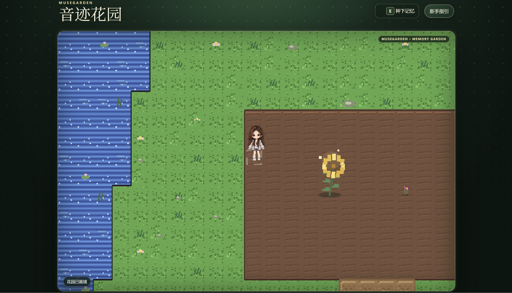
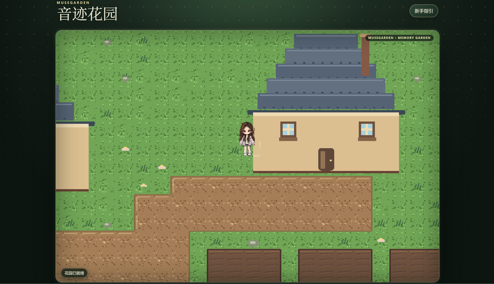
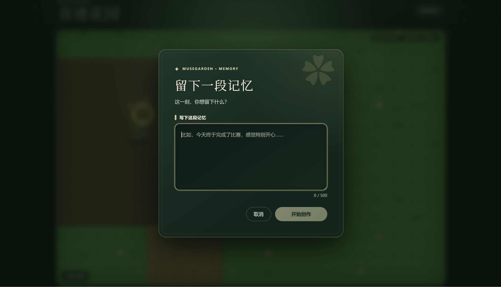
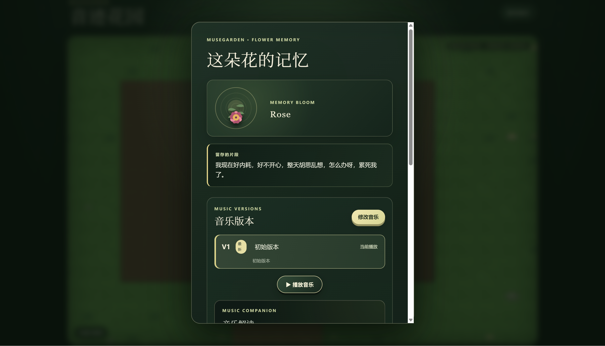
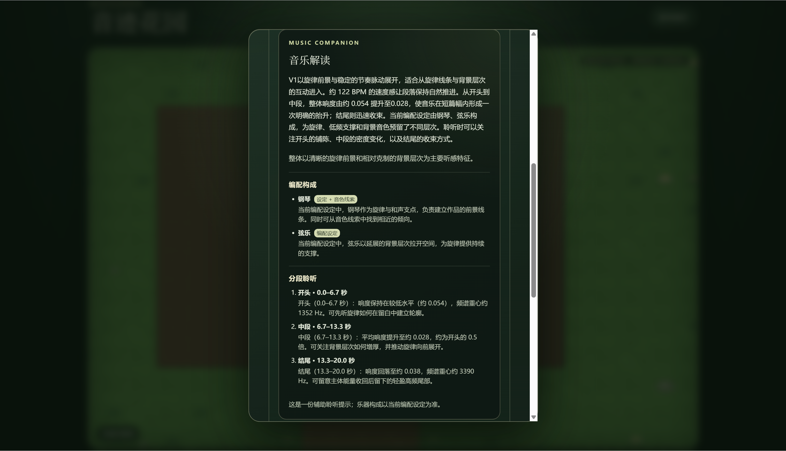
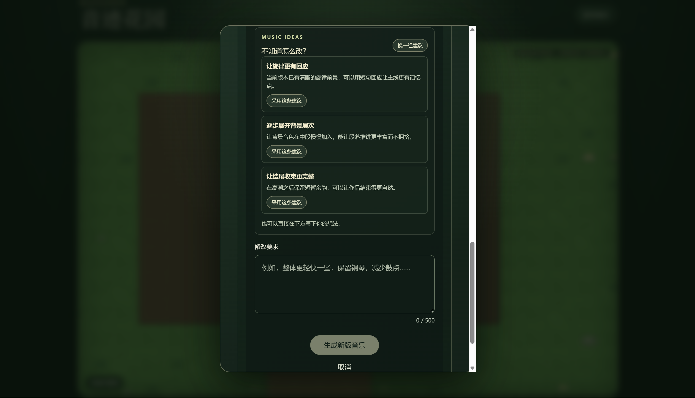
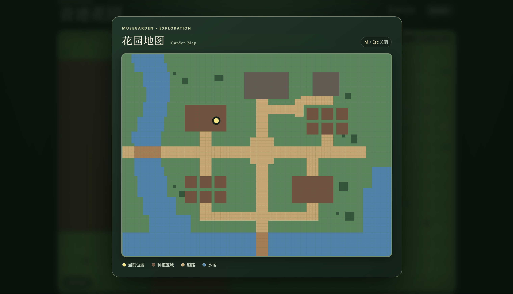

# MuseGarden 音迹花园

**把一段文字变成音乐与花朵，把回忆种进自己的花园。**

MuseGarden 是一个融合 AI 音乐创作与像素花园探索的个人项目。写下一段心情或经历，系统生成与之关联的音乐和花朵；回到花园时，可以重新聆听、查看记忆，或继续调整音乐。

[项目展示页](https://shadow-satr.github.io/MuseGarden/) · [Gitee Wiki](https://gitee.com/shaaaadowwww/muse-garden/wikis/Home) · [项目完整总结](docs/architecture/MuseGarden_项目过程与完整总结.md) · [运行说明](frontend/README.md)

> 以下为项目实际运行截图。展示页是静态介绍；完整音乐生成和花园交互需要在本机启动服务与模型。

## 实机画面

### 探索花园，种下记忆

控制角色探索像素世界，在空地写下文字，生成音乐并种下属于这段记忆的花。

查看更多花园场景

### 写下此刻

靠近空地按 **E**，输入文字并开始创作。音乐生成需要本地服务和模型就绪。

### 回访花朵与音乐

靠近花朵按 **E**，查看文字记忆、播放音乐并选择已有版本。

### 聆听、理解、继续创作

音乐解读提供辅助聆听信息；想改变音乐时，可以参考建议或自行填写修改要求。

展开音乐解读与修改界面

### 查看整个花园

按 **M** 打开地图，查看当前位置、种植区域、道路与水域。

## 基本操作

| 操作 | 按键 |
| --- | --- |
| 移动 | WASD 或方向键 |
| 在空地创作 / 查看花朵记忆 | E |
| 打开或关闭地图 | M；Esc 可关闭 |
| 移除附近的花朵 | Delete 或 Backspace |

花园支持 16 种花型，新建记忆时会选择花种并结合情绪生成配色。花朵详情可以查看所选音乐版本的 Blueprint；修改时以当前选中的版本为基础，并可查看结合音乐解读生成的建议。花朵移除后，种植位置可以重新使用；原始文字、音乐及其版本仍保存在本地归档。首次进入时有操作引导，也可通过“新手指引”再次查看。

## 项目与运行

正式代码：`ai_engine/`、`music_engine/`、`flower_engine/`、`application/`、`backend/`、`frontend/`。当前后端持久化数据在 `database/`，启动与导出入口在 `scripts/`。

当前产品进度：核心体验已完成并进入维护迭代。花园支持大世界摄像机、数据驱动的格子地图、
地形碰撞、444 个逐格种植位置、1×1 小花与 3×3 大花占地、四方向走路动画、脚底交互、真实创作与种花、花朵记忆详情，
以及音乐修改和历史版本选择。玩家可在花朵旁按 `Delete` 移除花朵并重新种植；首次进入时会显示操作引导，右上角“新手指引”可再次打开。
前端历史见 `docs/architecture/Frontend_progress.py`，当前地图规格见 `docs/architecture/Frontend_map_v1.md`，跨模块现状见 `docs/architecture/MuseGarden_progress.py`。

开发与历史资料统一放在 `development/`，包括旧网页 Demo、演示脚本、演示数据、评估占位目录和测试运行缓存。`test/` 是维护正式代码的 Python 回归测试源码，保留在项目根目录；`docs/` 保存方案和进度记录。

正式前端的启动说明见 [frontend/README.md](frontend/README.md)。开发资料清单见 [development/README.md](development/README.md)。
课程阶段材料、测试证据和交付说明位于 [`docs/course/课程材料/`](docs/course/课程材料/)；Gitee Wiki 与 GitHub Pages 的链接见其中的最终交付清单。

日常启动可直接双击项目根目录的 `启动 MuseGarden.bat`。它会确认或启动 Ollama、ACE-Step、
Garden API 与前端，并等待 ACE-Step 的 `acestep-v15-turbo` 模型完成初始化；全部就绪后才会
自动打开 `http://127.0.0.1:5182/`。
