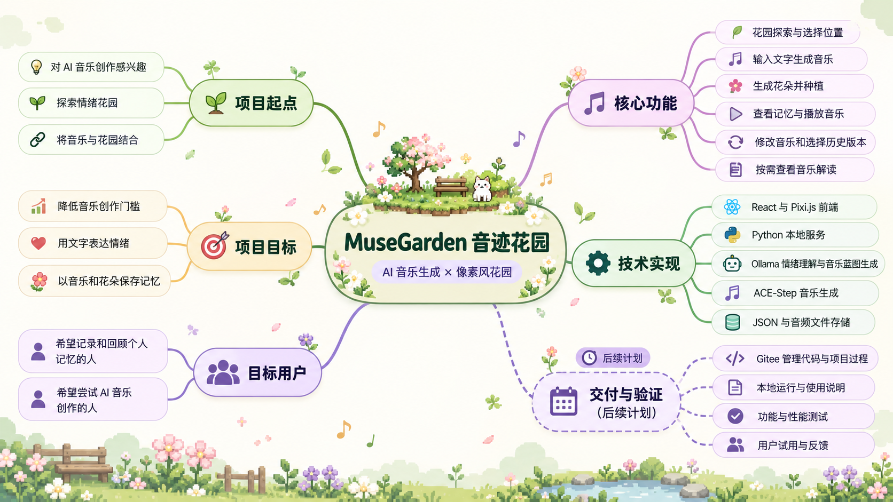

# MuseGarden 项目立项记录

## 一、项目基本信息

- **项目名称：** MuseGarden（音迹花园）
- **项目形式：** 个人独立开发的软件工程课程项目
- **项目负责人：** 待填写
- **立项时间：** 待填写（按实际情况记录）
- **项目仓库：** https://gitee.com/shaaaadowwww/muse-garden

MuseGarden 是一个结合 AI 音乐生成与像素风花园的应用。用户可以输入一段文字记忆，生成与之关联的音乐和花朵，并在虚拟花园中浏览、播放和回顾这些记忆。

**目标用户：** 希望用音乐和可视化方式记录、保存并回顾个人记忆的用户。

**核心功能：**

1. 在像素风花园中探索和选择种植位置。
2. 输入文字，生成与记忆关联的音乐和花朵。
3. 在花园中查看花朵对应的文字记忆并播放音乐。
4. 根据用户提出的要求修改音乐，并查看、选择历史版本。
5. 对已有音乐生成辅助解读，帮助用户了解音乐内容。

## 二、选题过程

项目最初的想法来自对 AI 与音乐结合的兴趣。音乐是一种特别的情绪表达方式，但传统音乐创作通常需要一定的专业知识和技能。因此，我希望尝试利用 AI 降低音乐创作门槛，让普通用户能够通过简单的文字表达情绪，并生成属于自己的音乐。

在构思过程中，我对 AI 虚拟乐队和情绪花园两个方向都比较感兴趣。经过思考，我决定将音乐创作与虚拟花园结合起来：用音乐承载用户表达的情绪，用花朵呈现和保存与音乐关联的记忆，让每一段回忆都能在花园中拥有一个位置。

最终，项目确定为 MuseGarden（音迹花园）。用户可以通过文字创建音乐记忆，并在像素风花园中查看花朵、播放音乐和回顾内容。我希望这种结合音乐与视觉空间的记录方式，能让回顾记忆的过程更加有趣、更有温度。

项目由个人独立完成。选题并非直接来源于某一部具体作品，而是由我对 AI 音乐和情绪花园的兴趣逐渐结合形成的。

## 三、选题思维导图

思维导图展示了项目起点、项目目标、目标用户、核心功能、技术实现以及后续交付与验证工作。其中“交付与验证”是后续计划，不代表相关工作已经全部完成。

## 四、NABCD 分析

### N — Need：用户需求

音乐能够表达情绪和承载回忆，但创作音乐通常需要一定的专业知识和技能。对于没有音乐创作经验的人来说，把自己的情绪转化成一首音乐并不容易。

此外，用户可以通过文字或照片记录生活，但这些记录未必能够呈现当时的情绪体验。MuseGarden 希望为用户提供一种新的记录方式：通过简单的文字输入，将情绪与记忆转化为音乐，并在花园中保存和回顾。

### A — Approach：解决方法

MuseGarden 将 AI 音乐生成与像素风虚拟花园结合。用户在花园中选择一块空地，输入想要记录的文字；系统分析文字内容，生成音乐蓝图，再生成音乐和与该次创作关联的花朵，并将花朵种植在花园中。

用户之后可以通过花朵查看对应的文字记忆、播放音乐，也可以提出修改要求，生成新的音乐版本。系统还提供按需生成的音乐解读，帮助用户了解已有音乐。

### B — Benefit：用户收益

- 用户无需掌握复杂的音乐创作知识，可以尝试通过文字生成个性化音乐。
- 每段音乐记忆都有一朵对应的花，用户可以在花园中浏览和回顾。
- 音乐和视觉元素为记忆记录提供了更多表达方式，使回顾过程更有趣。
- 用户可以修改音乐并保留历史版本，逐步探索更符合自己想法的作品。

这些收益是项目的设计目标，具体体验仍需要通过真实用户试用验证。

### C — Competitors：竞争与替代方案

用户可以使用文字日记、相册或备忘录记录生活，也可以使用 AI 音乐生成工具创作音乐。这些方式分别满足了记录或音乐创作的部分需求。

MuseGarden 的特点是把文字记忆、生成音乐和花园中的花朵关联起来，让用户通过探索花园来回顾内容。项目目前主要面向本地运行，在安装、模型资源和生成等待时间方面，可能存在使用门槛。

### D — Delivery：交付与推广

当前项目以本地应用的方式运行，使用时需要准备前端、后端及相关 AI 模型服务。课程阶段计划通过 Gitee 提供项目代码和使用说明，并制作软件介绍页面，说明获取和使用方法。

后续将邀请真实用户体验，收集他们在操作、音乐生成和花园浏览方面的反馈，再根据反馈确定改进方向。具体公开试用方式仍需结合运行条件确定。

## 五、立项记录说明

本项目由一名学生独立完成。立项内容根据本人对项目选题过程的描述整理；项目负责人姓名和实际立项时间待本人填写。教案所列的会议记录、参会者和会议照片要求，是否可以依据个人项目情况采用其他形式，需向任课教师确认。
